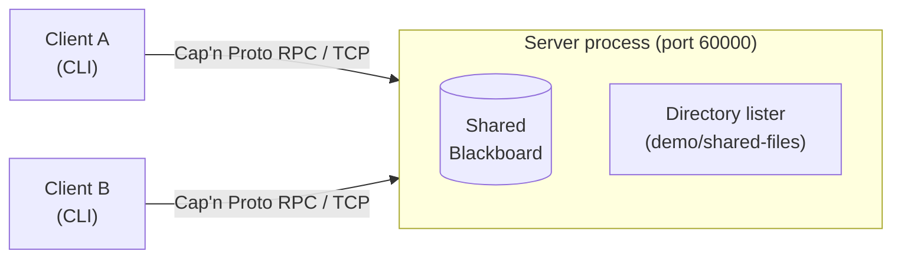

# Cap'n Proto RPC Blackboard

A small distributed application written for the seminar *Algorithms for Distributed Systems*.
It shows **Cap'n Proto RPC** (through the Python binding **pycapnp**) in action:

* a **shared blackboard** (key/value store) kept in memory by one server,
* a **remote directory listing** (`ls`) that reads the *server's* file system,
* any number of **independent CLI clients** that talk to the server over TCP.

Clients never talk to each other. They exchange information **indirectly** by writing to and
reading from the blackboard on the server (the classic blackboard communication pattern).

Everything goes through genuine Cap'n Proto RPC (`capnp.TwoPartyServer` / `capnp.TwoPartyClient`).
There is no HTTP, REST, gRPC or hand-written socket protocol.



## Requirements

| Item | Version used for development and testing |
|------|-------------------------------------------|
| Python | 3.12.7 (3.11 and 3.12 are supported) |
| pycapnp | 2.2.4 (`>=2.0.0,<3` is required; RPC in pycapnp 2.x is asyncio-based) |
| pytest / pytest-asyncio | 9.2.0 / 1.4.1 (only for the tests) |
| OS | Windows 11 (PowerShell). The code is cross-platform. |

pycapnp ships pre-built wheels for common platforms, so no C++ compiler is normally needed.

## Installation

**Windows (PowerShell)**

```powershell
cd capnproto-blackboard
python -m venv .venv
.\.venv\Scripts\Activate.ps1          # if scripts are blocked: Set-ExecutionPolicy -Scope Process Bypass
python -m pip install --upgrade pip
python -m pip install -e ".[dev]"
```

**Linux / macOS**

```bash
cd capnproto-blackboard
python3 -m venv .venv
source .venv/bin/activate
python -m pip install --upgrade pip
python -m pip install -e ".[dev]"
```

The editable install (`-e`) matters: the program finds `schema/blackboard.capnp` relative to the
repository. (Set the environment variable `CAPNP_DEMO_SCHEMA` to use another location.)

Check the installation:

```powershell
python -c "import capnp, sys; print(sys.version.split()[0], capnp.__version__)"
```

## Start the server

```powershell
python -m capnproto_demo.server --port 60000
```

Expected output:

```
Cap'n Proto RPC server listening on port 60000
  address     : 127.0.0.1:60000
  shared root : <path>\capnproto-blackboard\demo\shared-files
  press Ctrl+C to stop
```

Options: `--host` (default `127.0.0.1`; use `0.0.0.0` so other machines can connect),
`--port`, `--root` (directory clients may browse), `--latency` (artificial delay per blackboard
call, used only for the asynchronous-RPC demo).

## Start clients

Open one terminal per client (activate the virtual environment in each):

```powershell
python -m capnproto_demo.client --name A
python -m capnproto_demo.client --name B
```

From another machine: `python -m capnproto_demo.client --host <server-ip> --port 60000`
(start the server with `--host 0.0.0.0` and allow the port in the firewall).

The installed shortcuts `capnp-demo-server` and `capnp-demo-client` do the same.

### Commands

```
help                  show help
put <key> <value>     create or update an entry (quote values with spaces)
get <key>             read an entry
remove <key>          delete an entry
list                  show all entries
ls [directory]        list a directory on the SERVER
async-demo            compare sequential and concurrent RPC calls
exit                  quit
```

## Demo in 60 seconds

```
[A]> put topic "Distributed Systems"
Success: value stored.
[B]> get topic
Distributed Systems
[B]> put topic "Cap'n Proto RPC"
Success: value updated.
[A]> get topic
Cap'n Proto RPC
[A]> list
topic = Cap'n Proto RPC
[A]> ls .
Remote directory contents:

documents     DIRECTORY
config.json   FILE       136 bytes
example.txt   FILE       125 bytes
```

(File sizes may differ slightly on your machine.) See [docs/DEMO_GUIDE.md](docs/DEMO_GUIDE.md) for
the full script.

## Run the tests

```powershell
python -m pytest -v
```

The suite contains unit tests (blackboard, sandboxed file listing) and integration tests that start a
real server and talk to it through Cap'n Proto RPC, including a test with a separate server process
and separate client processes. On Windows one test (POSIX `chmod` permission errors) is skipped.

## Project layout

```
schema/blackboard.capnp        interface definitions (the "contract")
src/capnproto_demo/
    protocol.py                loads the schema with capnp.load()
    blackboard.py              the shared in-memory store (plain Python)
    filesystem.py              sandboxed directory listing (pathlib)
    server.py                  RPC server and servants
    client.py                  RPC client wrapper and interactive shell
demo/shared-files/             sample files for the `ls` demo
tests/                         pytest unit and integration tests
docs/                          explanations and the presentation guide
```

## Documentation

| File | Content |
|------|---------|
| [docs/ARCHITECTURE.md](docs/ARCHITECTURE.md) | Components and Mermaid diagrams |
| [docs/CAPNPROTO_EXPLAINED.md](docs/CAPNPROTO_EXPLAINED.md) | RPC and Cap'n Proto concepts, comparison with gRPC |
| [docs/BLACKBOARD_EXPLAINED.md](docs/BLACKBOARD_EXPLAINED.md) | The blackboard pattern vs. event-based communication |
| [docs/CODE_WALKTHROUGH.md](docs/CODE_WALKTHROUGH.md) | Following one request through the code |
| [docs/DEMO_GUIDE.md](docs/DEMO_GUIDE.md) | Exact demo commands with expected output |
| [docs/PRESENTATION_GUIDE.md](docs/PRESENTATION_GUIDE.md) | 18-minute talk: slides, notes, Q&A, requirement mapping |

## Troubleshooting

| Problem | Solution |
|---------|----------|
| `Error: cannot connect to 127.0.0.1:60000 ... Is the server running?` | Start the server first; check host and port. |
| `could not start the server ... address already in use` / `Only one usage of each socket address` | Another process uses the port. Stop it or choose `--port 60010` (and use the same port in the clients). |
| Client on another machine cannot connect | Start the server with `--host 0.0.0.0`, use the server's IP address, and open the port in the firewall. |
| `Cap'n Proto schema not found` | Run `pip install -e .` from the repository root, or set `CAPNP_DEMO_SCHEMA` to the path of `blackboard.capnp`. |
| `ModuleNotFoundError: capnp` | The virtual environment is not active, or pycapnp is not installed: `python -m pip install -e ".[dev]"`. |
| PowerShell refuses to run `Activate.ps1` | `Set-ExecutionPolicy -Scope Process Bypass`, then activate again. |
| `-c 'put topic "a b"'` loses its quotes in Windows PowerShell 5.1 | Use the interactive prompt, or pipe commands: `"put topic ""a b""" \| python -m capnproto_demo.client`. |
| `ls` says `access ... is not allowed` | By design: only paths inside the shared root are reachable (no absolute paths, no `..` escapes). |
| Installing pycapnp tries to compile and fails | Use Python 3.11/3.12 and a recent `pip` so a pre-built wheel is used. |
