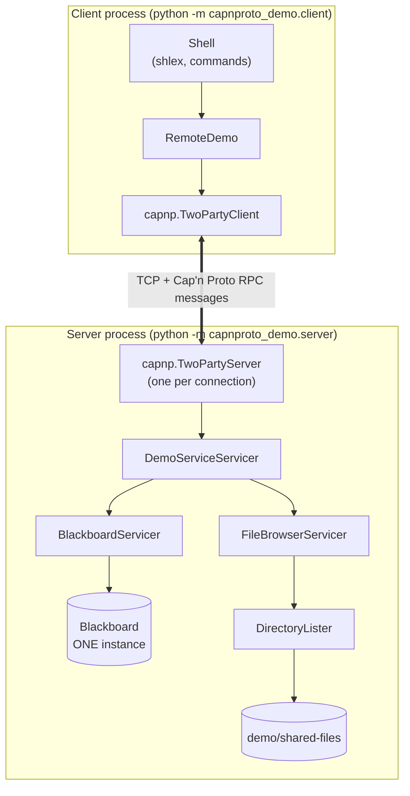
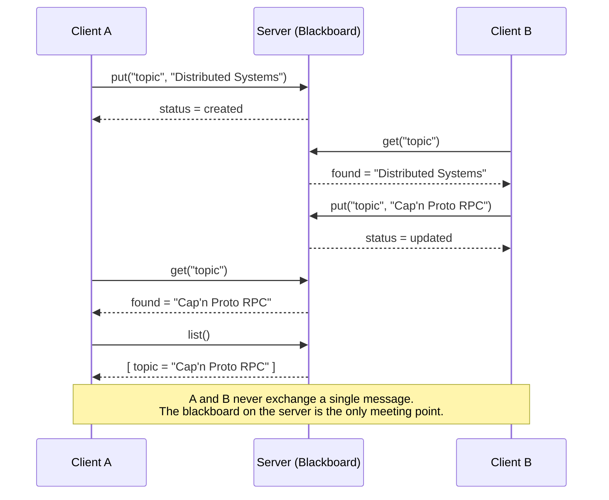
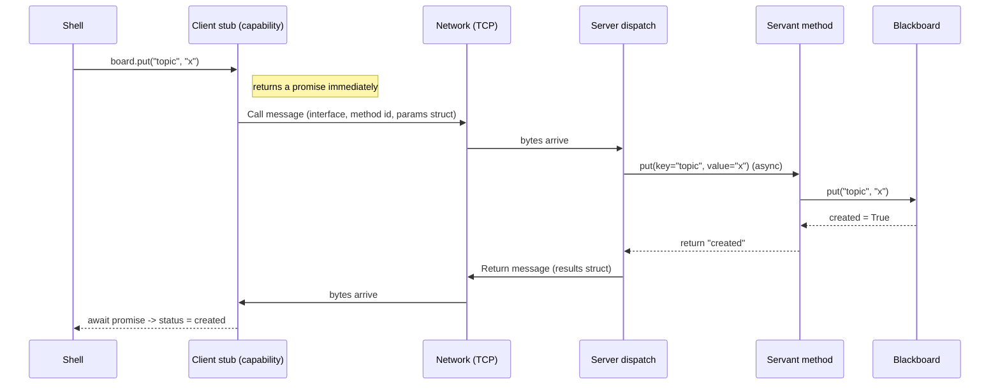
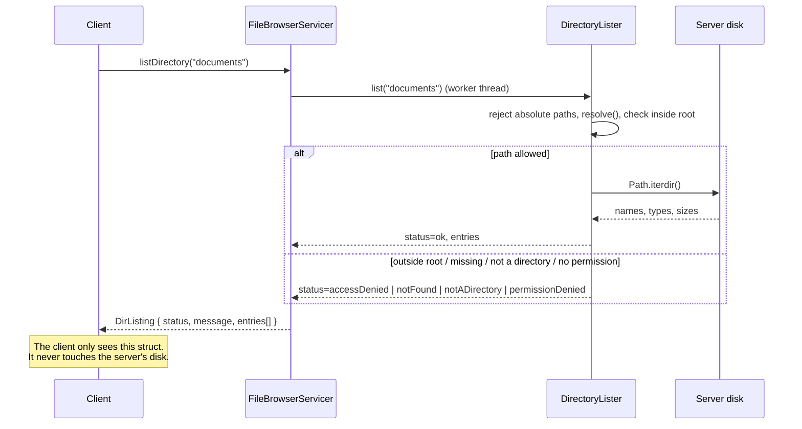

# Architecture

## Overview

One **server process** hosts two services behind a single Cap'n Proto interface:

* the **Blackboard**, a key/value store held in the server's memory, and
* the **FileBrowser**, which lists directories below a configured demo root.

Any number of **clients** connect over TCP. Each client has its own connection, but all connections
use the **same** `Blackboard` object. That is what makes the blackboard *shared*.

| Component | File | Responsibility |
|-----------|------|----------------|
| Interface definition | `schema/blackboard.capnp` | Methods, parameters, results |
| Schema loader | `protocol.py` | `capnp.load()` at run time |
| Blackboard | `blackboard.py` | Plain Python dict + lock. No networking. |
| Directory lister | `filesystem.py` | `pathlib` + sandboxing. No networking. |
| Servants | `server.py` | Classes implementing the interfaces; call the two classes above |
| Server lifecycle | `server.py` (`DemoServer`) | Listening socket, connections, shutdown |
| Client library | `client.py` (`RemoteDemo`) | Typed wrapper around the RPC capabilities |
| CLI | `client.py` (`Shell`) | Parses commands, prints results |

Separating "business logic" (`blackboard.py`, `filesystem.py`) from "RPC glue" (`server.py`) means
the logic is unit-testable without a network, and the RPC layer stays thin.

## 1. Client-server communication

Each connection gets its own `TwoPartyServer` and its own servant objects, but they are all
constructed with the same `Blackboard` instance owned by `DemoServer`.

## 2. Two clients, one blackboard

## 3. RPC request/response lifecycle

The client can start several calls before the first answer arrives (see `async-demo`). Each call
has an id, so answers can come back in any order.

## 4. Remote directory listing

### Safety rules in `filesystem.py`

1. Absolute paths (`/etc`, `C:\Windows`, UNC paths, `C:`), and NUL characters are rejected outright.
2. The path is joined to the root and passed through `Path.resolve()`, which collapses `..` and
   follows symlinks.
3. The resolved path must satisfy `is_relative_to(root)`. This blocks `..` traversal and symlinks that
   point outside the root with one check.
4. Entries that are themselves symlinks are reported as `SYMLINK` and never followed.
5. Errors are returned as an explicit `ListStatus` in the result, not as exceptions.

## Concurrency model

* The server is **single-threaded asyncio** integrated with the KJ event loop of Cap'n Proto
  (`capnp.run`). Blackboard methods never `await` between reading and writing the dict, so each
  operation is atomic with respect to other clients. A `threading.Lock` is added anyway to document
  the intent and protect against future multi-threaded use.
* Directory reads are blocking file-system calls, so they run in `asyncio.to_thread()` and do not
  stall other clients.
* The client reads keyboard input with `asyncio.to_thread(input, ...)` so the event loop (and the
  connection) stays alive while waiting for the user.

## Failure handling

| Situation | Behavior |
|-----------|----------|
| Server not running | `ConnectionFailed` with a hint; CLI exits with code 1 |
| Server stops during a session | next call raises `RpcError("connection to the server was lost")`; the shell prints an error |
| Missing key | explicit `missing` branch of the `Lookup` union, never an empty string |
| Empty key | server raises an error that reaches the client as `RpcError` |
| Bad directory / forbidden path | `ListStatus` value plus human-readable message |

## Deployment

Locally: three terminals (server, client A, client B). Across machines: start the server with
`--host 0.0.0.0` and point clients to its IP with `--host`. There is no encryption or
authentication in this demo (see "Known limitations" in `CAPNPROTO_EXPLAINED.md`).
