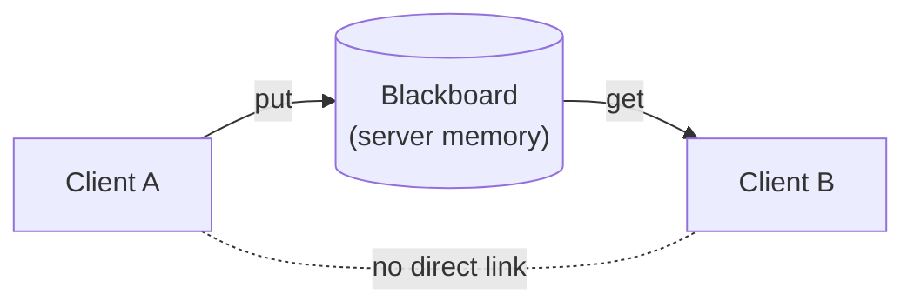

# The Blackboard Pattern Explained

## 1. What is a blackboard?

Imagine a classroom blackboard. Anyone can walk up and **write** something, **read** what is there,
**change** it, or **erase** it. Students do not need to talk to each other: they communicate *through*
the board.

In distributed systems, a **blackboard** is a shared data space that participants use to exchange
information indirectly. It belongs to the family of *indirect communication* models
(also known from tuple spaces and shared-data-space systems), in which sender and receiver are
**decoupled**:

* **Space decoupling**: writers and readers need not know each other, only the board.
* **Time decoupling**: a reader can read a value long after the writer disconnected.

## 2. In this project

The board lives **inside the server process** (`blackboard.py`) and has four operations:

| Operation | Meaning | Result |
|-----------|---------|--------|
| `put(key, value)` | create or replace an entry | `created` or `updated` |
| `get(key)` | read an entry | `found(value)` or `missing` |
| `remove(key)` | delete an entry | `true` if it existed |
| `list()` | read everything | list of `(key, value)` |

Clients invoke them by Cap'n Proto RPC:

### Shared state

There is exactly one `Blackboard` object (created in `DemoServer.__init__`). Every connection's
servant receives a reference to *that* object. The test
`test_two_clients_share_one_blackboard` asserts that what two clients see equals
`server.blackboard`.

### Indirect communication, step by step

1. Client A: `put topic "Distributed Systems"` creates the entry.
2. Client B (which A knows nothing about): `get topic` returns *Distributed Systems*.
3. Client B: `put topic "Cap'n Proto RPC"` updates it.
4. Client A: `get topic` now returns the new value. A "heard" from B without any message from B.

### Multiple clients and concurrency

* All blackboard operations run inside the server's single event-loop thread and never wait between
  reading and writing the dictionary, so each is **atomic**. Two simultaneous `put`s on one key are
  applied one after the other: the *last writer wins*. A lock additionally protects the store.
* The tests `test_many_concurrent_clients_do_not_lose_writes` (5 clients, 100 writes) and
  `test_concurrent_writes_to_same_key_end_in_one_consistent_value` check this.
* Consistency model: strong consistency for a single key (everyone reads the latest write) because
  there is one authority. There are no multi-key transactions.

### Missing keys vs. empty values

The schema's `Lookup` union has separate `found` and `missing` cases. `put empty ""` followed by
`get empty` prints `(empty string)`, whereas `get unknown` prints *does not exist*.

## 3. Comparison with event-based communication

| | Blackboard (chosen) | Event-based (publish/subscribe) |
|--|---------------------|--------------------------------|
| Model | Data is *pulled*: readers ask for the current state | Events are *pushed* to subscribers |
| Who initiates delivery? | Reader | Producer / broker |
| Typical question answered | "What is the value now?" | "Tell me when something happens" |
| Latency to notice change | Depends on polling interval | Immediate |
| Late joiners | See the full current state at once | Miss past events unless events are stored |
| History | Only the latest value per key | Event stream, can be replayed |
| RPC fit | Natural: request/response calls | Needs callbacks or streaming (e.g. client passes a capability to be called back) |

Cap'n Proto makes a push variant possible, because a client could pass a **callback capability** to
the server (`subscribe(listener :Listener)`). That would be the event-based extension of this demo. We
implemented the blackboard because it maps directly onto request/response RPC and is easy to see.

## 4. Advantages and disadvantages

**Advantages**

* Simple mental model; easy to demonstrate.
* Participants are decoupled and can join or leave at any time.
* Late joiners immediately see the current state.
* One place to inspect, debug and secure.

**Disadvantages**

* Central server: single point of failure and potential bottleneck.
* Pull-based: no notification when something changes (clients must poll).
* No history or ordering across keys; last-writer-wins can overwrite someone's update silently.
* Not persistent in this demo (memory only).

## 5. Typical use cases

* Configuration or status boards shared by several services.
* Coordination of cooperating components (the original blackboard architecture in AI: specialists
  read and write partial solutions to a shared board).
* Service registries, feature flags, shared caches.
* Tuple-space systems such as Linda, and distributed key-value stores such as etcd or Redis
  (which add replication and persistence).
