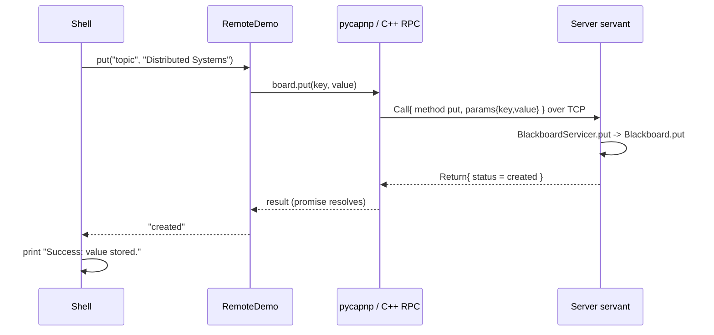

# Code Walkthrough

Follow one call, `put topic "Distributed Systems"`, from the keyboard to the server and back.

## Step 0: the schema (`schema/blackboard.capnp`)

```capnp
interface Blackboard {
  put @0 (key :Text, value :Text) -> (status :PutStatus);
  ...
}
enum PutStatus { created @0; updated @1; }
```

This is the contract. Both sides load it, so both agree on method names, parameter names and types.

## Step 1: loading the schema (`protocol.py`)

```python
@functools.cache
def load_schema():
    return capnp.load(str(schema_path()))
```

The returned module has `schema.Blackboard` (the interface), `schema.Blackboard.Server` (base class
for implementations), `schema.DemoService`, and so on. No generated files exist anywhere.

## Step 2: the server starts (`server.py`)

```python
self.blackboard = Blackboard()                         # the ONE shared board
self._server = await capnp.AsyncIoStream.create_server(
    self._on_connection, self.host, self.port)         # TCP listener
```

For every incoming TCP connection `_on_connection(stream)` runs:

```python
service = DemoServiceServicer(self.blackboard, self.lister, label, self.latency)
rpc_server = capnp.TwoPartyServer(stream, bootstrap=service)
await rpc_server.on_disconnect()
```

`bootstrap=service` is the first capability a client receives. All servants share
`self.blackboard`, so the state is common to all clients.

## Step 3: the servants (`server.py`)

```python
class BlackboardServicer(_schema.Blackboard.Server):
    async def put(self, key, value, _context, **kwargs):
        _require_key(key)
        created = self._board.put(key, value)
        return "created" if created else "updated"
```

Connection to the schema:

| Schema | Python |
|--------|--------|
| `interface Blackboard` | class inherits `schema.Blackboard.Server` |
| method `put` | method with the **same name** |
| params `(key, value)` | keyword arguments **named exactly like in the schema** |
| result `(status :PutStatus)` | a plain `return` fills the single result field; enums are strings |

For several results or structs, use `_context.results`, as in `get`:

```python
if value is None:
    _context.results.lookup.missing = None   # Void in a union is set with None
else:
    _context.results.lookup.found = value
```

## Step 4: the client connects (`client.py`, `RemoteDemo.connect`)

```python
stream = await capnp.AsyncIoStream.create_connection(host=host, port=port)
client = capnp.TwoPartyClient(stream)
service = client.bootstrap().cast_as(schema.DemoService)
board = service.blackboard().board        # pipelined: no await between the two calls
files = service.files().browser
```

* `bootstrap()` asks for the server's root capability. `cast_as` tells Python which interface it is
  (capabilities carry no run-time type information).
* `service.blackboard().board` is a *pipelined* call (see `CAPNPROTO_EXPLAINED.md`).

## Step 5: the user types a command (`client.py`, `Shell`)

```python
line = await asyncio.to_thread(input, prompt)      # does not block the event loop
parts = shlex.split(line)                          # ['put', 'topic', 'Distributed Systems']
```

`shlex.split` understands quotes, so `"Distributed Systems"` stays one argument. `Shell._put`
validates the argument count and calls `RemoteDemo.put`.

## Step 6: the RPC call (`RemoteDemo.put`)

```python
promise = self._board.put(key, value)      # builds the params struct, sends the Call message
status  = str((await promise).status)      # the await suspends only this coroutine
```

On the wire:



## Step 7: the answer on screen

`Shell._put` maps `"created"` to `Success: value stored.` and `"updated"` to
`Success: value updated.`. Client B's `get` runs the same path with `BlackboardServicer.get`, which
reads from the same `Blackboard` object.

## The directory listing path

`ls documents` becomes `RemoteDemo.ls("documents")`, which calls `files.listDirectory("documents")`.

Server side:

```python
result = await asyncio.to_thread(self._lister.list, path)     # blocking I/O off the event loop
_context.results.listing = {"status": ..., "message": ..., "entries": [...]}
```

`DirectoryLister.list` (`filesystem.py`) is where `pathlib` is used and the root is enforced:

```python
candidate = (self.root / requested).resolve(strict=False)
return candidate if candidate.is_relative_to(self.root) else None
```

The schema returns a `DirListing` struct that contains a `ListStatus` and a list of
`DirEntry { name, type, size }`. The client turns it into `Remote directory contents: ...` text.
The client never opens a directory itself.

## Lifecycle and shutdown

* `DemoServer.stop()` closes the listener and all open streams; `main()` handles `KeyboardInterrupt`.
* `RemoteDemo.close()` drops the capabilities, then closes the `TwoPartyClient` and the stream. The
  server notices through `on_disconnect()` and logs `client-N disconnected`.

## Why the code is organised this way

| File | Knows about RPC? | Tested without a network? |
|------|------------------|----------------------------|
| `blackboard.py` | no | yes (`test_blackboard.py`) |
| `filesystem.py` | no | yes (`test_filesystem.py`) |
| `server.py` | yes | through `test_rpc_integration.py` |
| `client.py` | yes | through `test_rpc_integration.py` |

## Gotchas found while building it (pycapnp 2.2.4)

* RPC server methods **must** be `async def`; a plain `def` fails with "Server function ... is not a coroutine".
* RPC calls only work inside `capnp.kj_loop()` / `capnp.run()`.
* Close the client connection before the server closes; the helper `DemoServer.stop()` closes any
  remaining streams so shutdown does not hang.
* `AsyncIoStream.wait_closed()` raised an `AttributeError` for client streams in this version, so the code does not use it.
