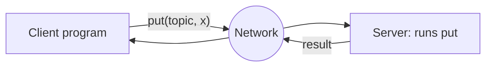
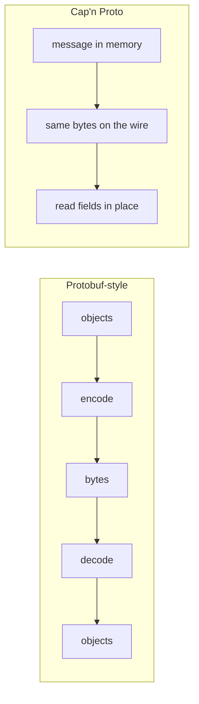
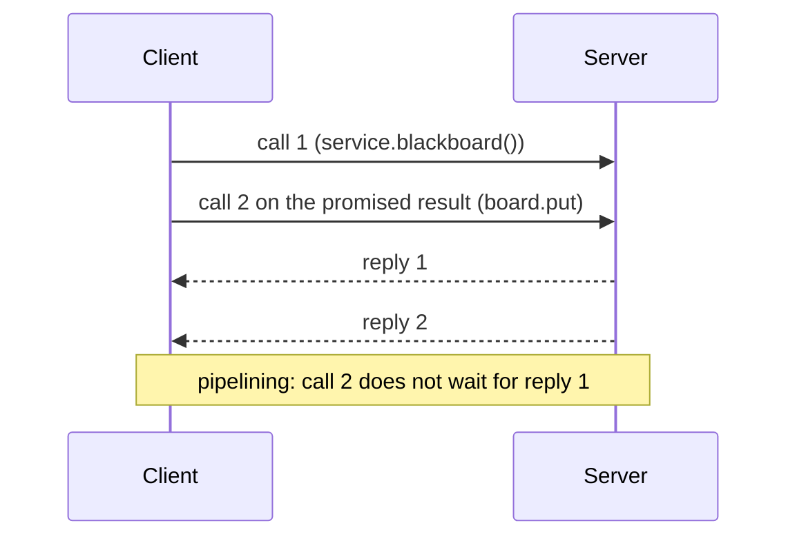
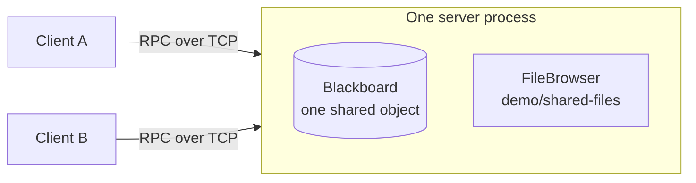
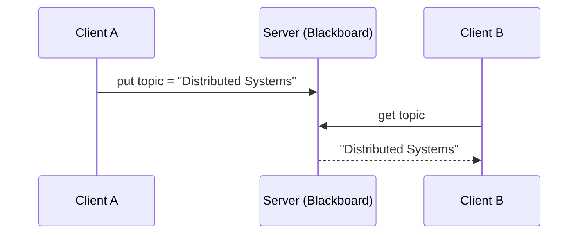
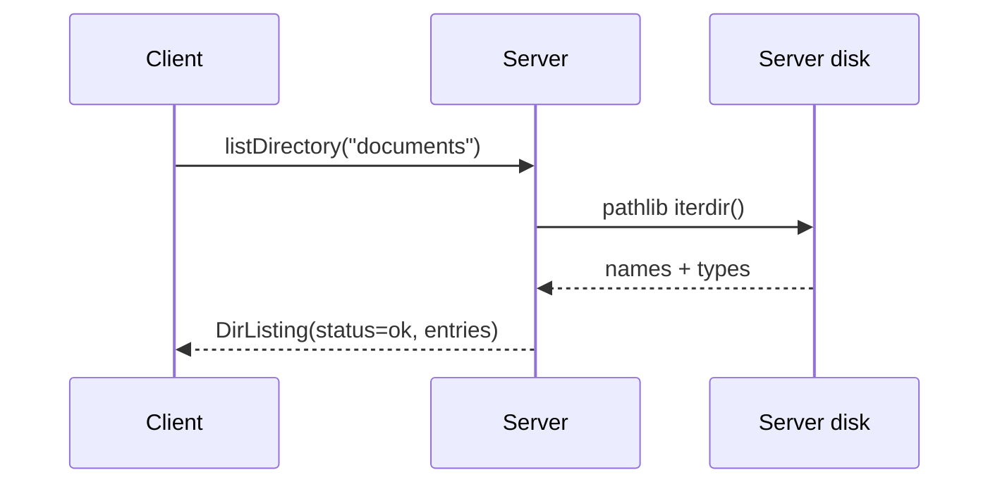

# Presentation Guide (about 18 minutes)

**Title:** *From Local Method Calls to Distributed Communication: How Cap'n Proto RPC Enables a Shared Blackboard*

## 0. What to focus on (recommendation)

Fifteen to twenty minutes is short. The assignment says *"do not attempt to go into every detail"*, so
choose **one story** and let the demo carry it:

> **"A remote call should feel like a local call. Cap'n Proto makes it cheap (no serialization step)
> and fast (promise pipelining), and we prove it with a blackboard."**

Spend your time like this:

| Focus | Why it is a good choice | Time |
|-------|------------------------|------|
| 1. **Interface definition (IDL)** | Shows the "contract": the schema *is* the RPC API. Easy to show on one slide. | high |
| 2. **What is distinctive: zero-copy serialization and promise pipelining** | Answers "why Cap'n Proto instead of X?", and pipelining is a memorable, visual idea. | high |
| 3. **Link to the lecture** (request/reply, transparency, failures, indirect communication) | Shows you can connect the tool to theory; professors reward this. | medium |
| 4. Demo: blackboard and `ls` | Required, and the audience remembers demos. | high |
| 5. Comparison with gRPC | One slide, as a closing contrast. | low |

What to **skip or only mention**: the binary wire layout, packed encoding, the RPC protocol levels,
schema evolution rules, TLS. Keep them for the Q&A.

Suggested "hook" for the first minute: *"When you call `board.put()` in this program, the function
body runs on a different computer. What has to happen to make that look like a normal call?"*

## 1. Timeline

| Part | Topic | Minutes | Slides |
|------|-------|---------|--------|
| 1 | Introduction: RPC | 2 | 1-2 |
| 2 | Cap'n Proto fundamentals | 4 | 3-6 |
| 3 | Application architecture | 3 | 7-8 |
| 4 | Blackboard demo | 4 | 9-10 |
| 5 | Remote directory listing | 3 | 11-12 |
| 6 | Conclusion | 2 | 13-14 |
| | **Total** | **18** | 14 |

Two minutes of slack remain inside the 15-20 minute window. If you are running late, drop the
"async" demo and slide 6 detail. If early, run `async-demo`.

Roles for two or three speakers: Speaker 1 parts 1-2, Speaker 2 parts 3-4 (operates the demo),
Speaker 3 (or 1) parts 5-6.

---

## Part 1: Introduction (2 min)

### Slide 1: Title and hook
**On the slide:** title, names, course, a one-line question: *"What if calling a function on another
computer was as easy as calling a local one?"*

**Speaker notes:** Introduce the topic. Mention what we will show: a shared blackboard and a remote `ls`.

### Slide 2: Why RPC?
**On the slide:** a local call `board.put("topic", x)` next to a diagram with a network between client and server.



**Speaker notes (about 1.5 minutes):**
* Distributed systems need processes on different machines to cooperate. Sockets are low-level: you
  must define message formats, parsing, dispatch.
* RPC hides this: a stub serializes arguments, sends them, the server executes, replies. That is
  *access transparency* from the lecture.
* But it is only *partly* transparent: the network can fail (the lecture's failure models: crash,
  omission, delay), so call semantics (at-most-once, at-least-once) matter.
* An RPC framework needs: an IDL, serialization, transport, dispatch.

---

## Part 2: Cap'n Proto fundamentals (4 min)

### Slide 3: What is Cap'n Proto?
**On the slide:**
* Serialization format *and* RPC system, by Kenton Varda (author of Protobuf v2).
* C++ core; bindings for many languages. We use **pycapnp** (Python binding to the C++ library).
* Three ideas: **schema**, **no encode/decode step**, **capabilities + promise pipelining**.

### Slide 4: The interface definition (IDL)
**On the slide** (the real schema, abbreviated):

```capnp
interface Blackboard {
  put    @0 (key :Text, value :Text) -> (status :PutStatus);
  get    @1 (key :Text)              -> (lookup :Lookup);
  remove @2 (key :Text)              -> (removed :Bool);
  list   @3 ()                       -> (entries :List(Entry));
}
struct Lookup { union { found @0 :Text; missing @1 :Void; } }
```

**Speaker notes (about 1.5 minutes):**
* The schema *is* the contract. Both sides read the same file.
* `@0 @1` are permanent numbers: renaming is safe, reordering is not. This enables evolution.
* The union solves a real design problem: *missing key* is not the same as *empty string*.
* In Python: `capnp.load("blackboard.capnp")`. **No code generation step.** This differs from
  gRPC's `protoc` workflow.

### Slide 5: Serialization: "the encoding step that isn't there"
**On the slide:** two rows.



**Speaker notes:** The wire format resembles the in-memory layout with relative pointers, so the
receiver can read fields directly from the received buffer (zero-copy reads). Be honest: in Python,
accessing fields still creates Python objects, so the largest benefits show up in C++/Rust and with
large messages.

### Slide 6: Asynchronous RPC and promise pipelining
**On the slide:**

```python
p1 = board.put("a", "1")      # sent, not awaited
p2 = board.put("b", "2")      # sent, not awaited
await p1; await p2            # wait once
```



**Speaker notes:** A call returns a *promise*. With a real round-trip time of, say, 50 ms, waiting
for each answer before the next call costs 50 ms each. Pipelining lets dependent calls travel
together. We measured the asynchronous effect with an artificial 0.5 s server delay:
sequential 1.55 s vs concurrent 0.52 s (you will see it in the optional demo).
pycapnp runs this on asyncio and the C++ KJ event loop (`capnp.run`).

---

## Part 3: Application architecture (3 min)

### Slide 7: Architecture


**Speaker notes:**
* One server, many clients, one TCP connection each; the server exposes a single bootstrap interface
  `DemoService` giving access to `Blackboard` and `FileBrowser`.
* The key line: *all connections receive the same `Blackboard` object*. That is what makes it shared.
* Business logic (`blackboard.py`, `filesystem.py`) has no RPC code; `server.py` is a thin adapter.

### Slide 8: Server and client in code
**On the slide:**

```python
class BlackboardServicer(schema.Blackboard.Server):
    async def put(self, key, value, _context, **kwargs):
        created = self._board.put(key, value)
        return "created" if created else "updated"
```
```python
client = capnp.TwoPartyClient(stream)
board = client.bootstrap().cast_as(schema.DemoService).blackboard().board
status = (await board.put("topic", "x")).status
```

**Speaker notes:** Method names and parameter names match the schema exactly. The server method is a
coroutine (pycapnp 2.x). Concurrency: the server runs in one event loop, so each operation is atomic.

---

## Part 4: Blackboard demonstration (4 min)

### Slide 9: The blackboard pattern
**On the slide:** the two-client diagram and text: *"Indirect communication: A and B never talk to each other."*



**Speaker notes:** Decoupled in space and time; contrast with event-based (push, subscribers) in one
sentence. We chose the blackboard since it is pull-based and maps directly to request/response RPC.

### Slide 10: LIVE DEMO 1: two clients
Three windows are ready: Server, A, B (see [DEMO_GUIDE.md](DEMO_GUIDE.md)).

| # | Window | Command | Expected output |
|---|--------|---------|-----------------|
| 1 | Server | `python -m capnproto_demo.server --port 60000` | `Cap'n Proto RPC server listening on port 60000` |
| 2 | A | `python -m capnproto_demo.client --name A` | `Connected. ...` |
| 3 | B | `python -m capnproto_demo.client --name B` | `Connected. ...` |
| 4 | A | `put topic "Distributed Systems"` | `Success: value stored.` |
| 5 | B | `get topic` | `Distributed Systems` |
| 6 | B | `put topic "Cap'n Proto RPC"` | `Success: value updated.` |
| 7 | A | `get topic` | `Cap'n Proto RPC` |
| 8 | A | `list` | `topic = Cap'n Proto RPC` |
| 9 | B | `get unknown` | `Key 'unknown' does not exist on the blackboard.` |

**Speaker notes:** Narrate: "A writes. B has never heard of A, yet it reads the value." Then point to
the server window: every call is logged there. Ask the audience to predict A's `get` result before
pressing Enter (engagement). Step 9: missing key is an explicit case, not an empty string.

**Backup if the live demo fails:** show the transcript from DEMO_GUIDE section 5 on a slide, or run
`python -m pytest tests/test_rpc_integration.py -k two_clients -v`.

---

## Part 5: Remote directory listing (3 min)

### Slide 11: How `ls` works over RPC
**On the slide:**

```capnp
interface FileBrowser {
  listDirectory @0 (path :Text) -> (listing :DirListing);
}
struct DirEntry   { name @0 :Text; type @1 :EntryType; size @2 :UInt64; }
struct DirListing { status @0 :ListStatus; message @1 :Text; entries @2 :List(DirEntry); }
```



**Speaker notes:** This is the HowTo the task asks for: (1) define the method in the schema,
(2) implement it on the server with `pathlib`, (3) call it from the client. Mention the safety
rules: restricted to a demo root; absolute paths, `..` and symlink escapes are rejected; errors are
explicit statuses, not crashes.

### Slide 12: LIVE DEMO 2: `ls`
| # | Command | Expected output |
|---|---------|-----------------|
| 1 | `ls .` | `Remote directory contents:` then `documents DIRECTORY`, `config.json FILE`, `example.txt FILE` |
| 2 | `ls documents` | `notes.md FILE`, `slides.txt FILE` |
| 3 | `ls ../..` | `Error: access to '../..' is not allowed (...)` |
| 4 | `ls nope` | `Error: 'nope' does not exist` |

**Speaker notes:** Before step 1, create a new file in `demo\shared-files` in File Explorer; it appears
in the next `ls`. That proves the data comes from the server's disk. Say: "The client only receives
the `DirListing` struct."

**Optional (time permitting):** restart the server with `--latency 0.5`, run `async-demo`.

---

## Part 6: Conclusion (2 min)

### Slide 13: Benefits and limitations
| Benefits | Limitations |
|----------|-------------|
| Schema-first contract | Smaller ecosystem than gRPC |
| No serialization step, no code generation in pycapnp | No built-in TLS/auth |
| Promise pipelining | Calls look local but can fail: exceptions needed |
| Capabilities (objects passed over the network) | Our blackboard: single point of failure, memory-only, last-writer-wins |

### Slide 14: Connection to distributed-systems theory
* Request-reply and **access transparency**; **failure transparency is not achieved** (we surface errors).
* **Indirect communication**: blackboard / shared data space (decoupling in space and time).
* **Asynchrony**: futures/promises; concurrency control: single event loop, atomic operations.
* **Security / capability model**: references as authority; our server limits filesystem access.
* Compared with gRPC: different trade-offs (zero-copy + capabilities vs. ecosystem + streaming).

**Closing line:** *"RPC lets the blackboard on one computer be used as if it were next to you. Cap'n
Proto makes that cheap, and the schema keeps both sides honest."* Then invite questions.

---

## Likely professor questions

| Question | Suggested answer |
|----------|-------------------|
| What semantics does the RPC offer (at-most-once, at-least-once)? | Calls travel over one reliable TCP connection and are delivered in order. If the connection breaks, the pending call fails; Cap'n Proto does **not** retry automatically. So it is effectively at-most-once per connection, and the application decides about retries. Our `put` is idempotent, so a manual retry is safe. |
| How do you handle concurrent clients? | One asyncio event loop in the server; each blackboard operation runs without yielding, so it is atomic. Same-key writes are last-writer-wins. Tests use five parallel clients (100 writes) without loss. |
| Why Cap'n Proto instead of gRPC? | It avoids the encode/decode step, supports promise pipelining and capabilities. gRPC offers a bigger ecosystem, streaming, HTTP/2, and built-in security. Choose by need. |
| Is there a code-generation step? | Not in Python: `capnp.load()` parses the schema at run time. C++ uses `capnp compile`. |
| Is it really zero-copy in Python? | The wire format allows reading in place; the C++ layer does not copy. In Python, reading a field still creates Python objects, so the gain is smaller than in C++. |
| What if the server crashes? | The client's next call fails with an error (`connection to the server was lost`) and the session stays alive. The blackboard content is lost because it is only in memory: persistence or replication would be needed. |
| How do you stop path traversal? | The path is resolved (`..` and symlinks collapsed) and must stay within the root (`is_relative_to`). Absolute paths and NUL are rejected. Tests cover `..`, absolute, UNC, drive paths and a symlink escape. |
| Is it secure on a network? | Not as delivered: there is no authentication or encryption. pycapnp lets you wrap the connection with TLS; or tunnel it. |
| What is a capability here? | `DemoService` returns `Blackboard` and `FileBrowser` objects. Holding a reference lets you call it; a server could hand out restricted references (e.g. read-only board). |
| Blackboard vs. event-based? | Pull vs. push. The blackboard gives current state and supports late joiners; events give immediacy and history. An event variant could be built by passing a callback capability to the server. |
| What is promise pipelining? | Calling a method on the result of an earlier call before it returns, so dependent calls travel without waiting for a round trip. We use it when obtaining `board` from `service.blackboard()`. |
| How does the CLI avoid blocking the connection while waiting for input? | `input()` runs in a worker thread (`asyncio.to_thread`), so the event loop stays free. |
| What would you improve? | Authentication/TLS, persistence, subscriptions (event-based) via callback capabilities, per-key access control, compare-and-set for safe concurrent updates. |

## Assignment requirement mapping

| Requirement (from the task) | Where it is satisfied |
|-----------------------------|-----------------------|
| Talk about an RPC framework for 15-20 minutes | This guide, 14 slides, about 18 minutes |
| Implement a **blackboard** using RPC | `schema/blackboard.capnp` (`Blackboard`), `src/capnproto_demo/blackboard.py`, `BlackboardServicer` in `server.py`; tests `test_two_clients_share_one_blackboard` etc. |
| HowTo: read a folder on a remote machine and show it on the client | `FileBrowser.listDirectory` in the schema, `filesystem.py`, `FileBrowserServicer`, `Shell._ls`; Slides 11-12; tests `test_remote_directory_listing` |
| General design / architecture | Slide 7; `docs/ARCHITECTURE.md` |
| In-depth detail: serialization, promise pipelining | Slides 5-6; `docs/CAPNPROTO_EXPLAINED.md` |
| Communication protocols | Slide 6, `CAPNPROTO_EXPLAINED.md` sections 4, 6 and 9 (transport, framing, comparison with gRPC) |
| Interface definitions | Slides 4 and 11; `schema/blackboard.capnp` |
| Relation to the lecture | Slide 14, `docs/BLACKBOARD_EXPLAINED.md`, Q&A |
| Use case scenarios | `BLACKBOARD_EXPLAINED.md` section 5 |
| Interesting, entertaining, insightful | Live two-client demo with audience prediction; `async-demo` timings; security demo (`ls ../..`) |
| Don't go into every detail | Section 0: what to skip |
| Real Cap'n Proto RPC (no sockets/HTTP) | `TwoPartyServer` / `TwoPartyClient` in `server.py` and `client.py` |
| Multiple clients, shared blackboard | One `Blackboard` in `DemoServer`; test with 5 parallel clients |
| Directory safety, errors, demo directory | `filesystem.py`; `test_filesystem.py`; `demo/shared-files/` |
| Automated tests | `tests/` (run `python -m pytest -v`) |

## Rehearsal checklist

* [ ] `python -m pytest -q` passes on the presentation laptop.
* [ ] Three terminals open and the venv active in each; large font.
* [ ] Server started *before* the clients; port 60000 free.
* [ ] `demo\shared-files` contains `example.txt`, `config.json`, `documents\`.
* [ ] Slides with transcripts ready as a fallback (DEMO_GUIDE sections 5 and 6).
* [ ] Time the talk once; target 17-18 minutes.
